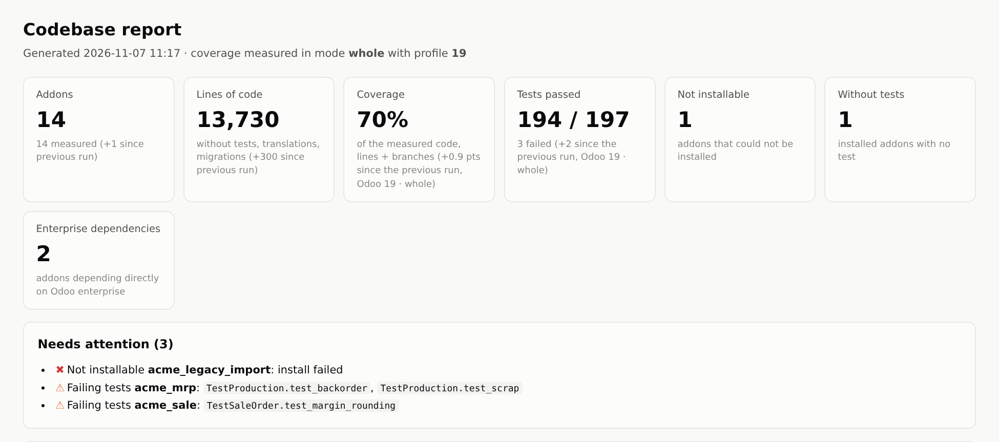
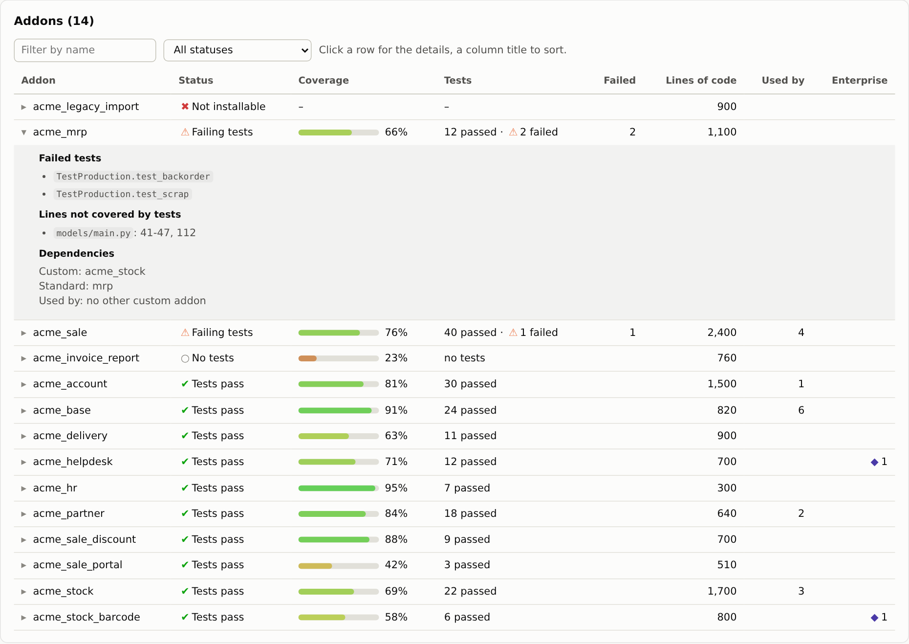
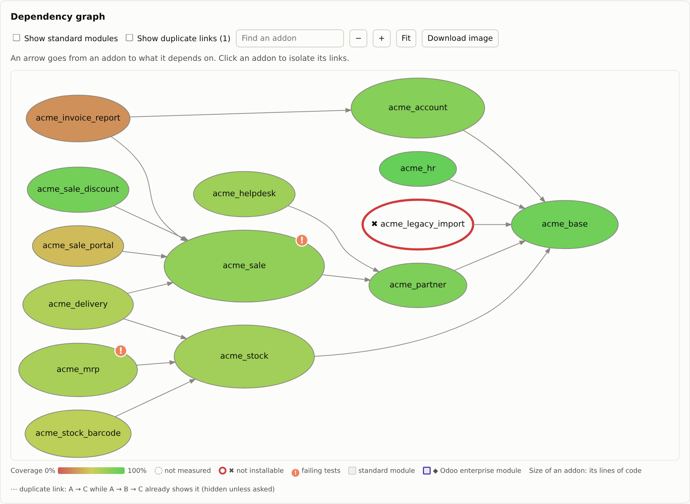
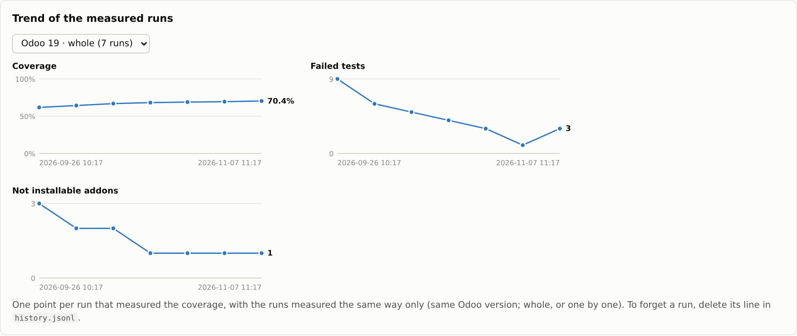
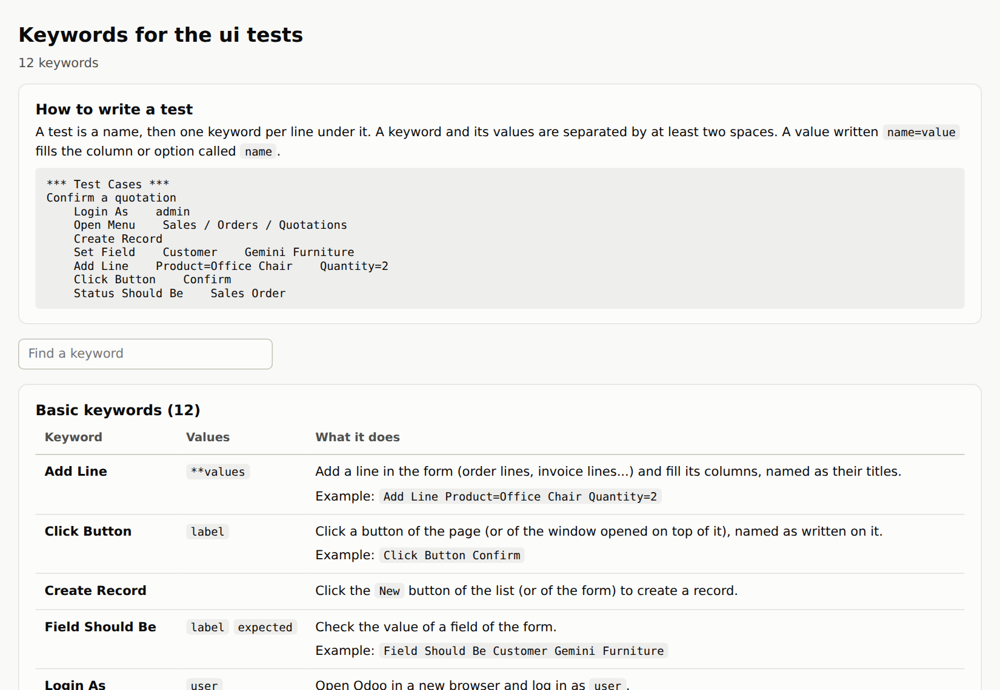
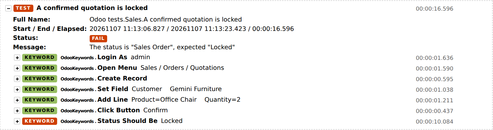
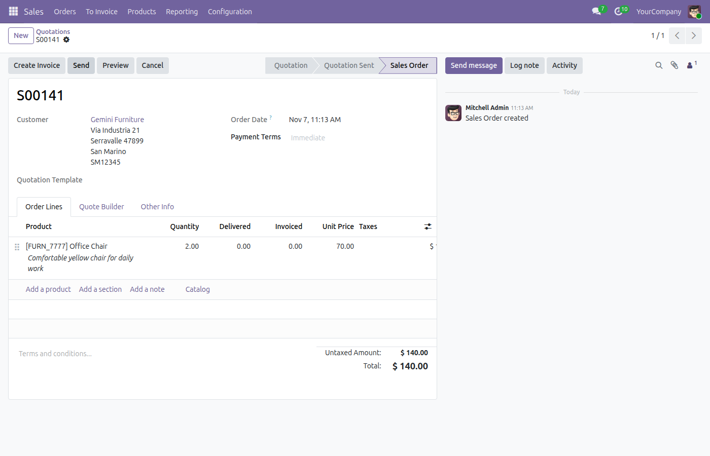

# jsa guide

Everything the [README](../README.md) leaves out: the full setup, the configuration, how each command works, the ui
tests, your own commands and the development of jsa itself.

- [Installation in detail](#installation-in-detail)
- [config.toml](#configtoml)
- [Databases](#databases)
- [Codebase report and test coverage](#codebase-report-and-test-coverage)
- [Finding the commit that broke a test](#finding-the-commit-that-broke-a-test)
- [UI tests](#ui-tests)
- [Your own commands (plugins)](#your-own-commands-plugins)
- [Odoo versions](#odoo-versions)
- [Developing jsa](#developing-jsa)

## Installation in detail

**Requirements**
- Linux, or WSL on Windows (tested on Ubuntu 22.04 and 24.04), Python 3.10 or later and `pipx`.
- PostgreSQL: the client tools (`psql`, `createdb`, `dropdb`) and a server your user can connect to without a
  password, as for Odoo itself. Your role does not need to be superuser: `restore` uses `sudo -u postgres` only for
  the extensions only a superuser can create (pgvector, used by Odoo's AI features).
- `git`, for `jsa update`, `jsa version` and `jsa bisect`.
- Optional: graphviz (`dot`) to draw the dependency graph of the report.
- For the commands that run Odoo (coverage, `--neutralize`, `bisect`, ui tests with `-p`): the Odoo sources and a
  Python environment able to run them, described as a profile in `config.toml`.

**Install**
```bash
sudo apt install pipx postgresql-client graphviz
pipx ensurepath                      # once: puts ~/.local/bin on your PATH, then open a new terminal
git clone https://github.com/Minijump/jsa_dev_toolbox.git jsa_dev_toolbox && cd jsa_dev_toolbox
pipx install -e .                    # -e: jsa runs the code of this folder
cp config.example.toml config.toml   # then adapt it, see below
jsa doctor                           # checks PostgreSQL, pgvector, graphviz, config.toml, profiles...
```
jsa works from any folder, but always reads its dumps in `dumps/` and writes its reports in `codebase_analysis/`
inside the toolbox folder.

**What is where.** Everything in `jsa/` is the tool. Everything else at the root is yours or generated, and ignored by
git: `config.toml`, `dumps/`, `plugins/` (your commands), `uitests/` (your ui tests and keywords),
`codebase_analysis/` (reports).

**Updating.** `jsa update` pulls the toolbox folder and reinstalls jsa (needed when its dependencies change).
`jsa version` tells which code runs and whether the remote has newer commits. To do it by hand:
`git pull`, then `rm -rf build && pipx uninstall jsa-dev-toolbox && pipx install -e .`.

**WSL.** The reports open in the Windows browser (through `explorer.exe`).

## config.toml

`config.example.toml` holds every setting, commented. The sections:

**`[codebase]`**
- `addons_roots`: the folders of your custom addons (OCA ones included if you want them in the report). Read by
  `structure`, `pending-upgrades` and the ui tests' `--new-db`.

**`[profiles.<name>]`**: one per Odoo installation, chosen with `-p <name>`.

| Key | |
|---|---|
| `python` | the Python that runs this Odoo (it needs `coverage` installed for `structure -c`) |
| `odoo_root`, `odoo_bin` | the Odoo sources and their `odoo-bin` |
| `addons_paths` | as in Odoo's own configuration: your addons, then Odoo's (and enterprise's) |
| `enterprise` | optional: the enterprise folder. Its modules are the "enterprise modules" flagged by the report |
| `db_prefix` | prefix of the temporary databases of the coverage runs (default `cov`) |

**`[[restore.extra_steps]]`**: what `jsa restore` does to a restored database, one block per step, in this order.

| Key | |
|---|---|
| `label` | what is printed |
| `sql` | the SQL to run, or |
| `command` | a jsa command instead (typically one of your plugins), called with the database name at its end |
| `requires` | `["table"]` or `["table.column"]`: skipped when it does not exist (module not installed) |
| `odoo_versions` | e.g. `[19]`: skipped on the databases of the other versions |
| `enabled` | `false` keeps the step in the file without running it |

The SQL steps run in one transaction (all or nothing), then the commands one by one. A failing command is reported
and the next steps still run. A misspelled key is refused before anything starts. The example file has the usual
steps: 2FA off, login `admin` / password `admin`, expiration date, outgoing mail servers (switched off by default).

**`[uitests]`**: see [UI tests](#ui-tests). **`plugins_dirs`**: see [plugins](#your-own-commands-plugins).

## Databases

**`jsa restore <db> [zip]`** restores an Odoo backup zip (as downloaded from odoo.sh or the database manager):
1. The zip is looked for in `dumps/` (or given as a path; with a single zip in `dumps/` the name can be left out).
   Only `dump.sql` and `filestore/` are extracted.
2. `<db>` is dropped and created again. The extensions only a superuser can create are created first, with
   `sudo -u postgres` when your role is not superuser (`--postgres-user` for another system user).
3. The dump is loaded with a progress line. SQL errors stop it before anything is sanitized
   (`--ignore-sql-errors` goes on anyway); the harmless "must be owner of extension" ones are ignored.
4. The filestore, if any, goes to `<data-dir>/filestore/<db>` (`--data-dir`, default `~/.local/share/Odoo`).
5. `--neutralize -p <profile>` runs `odoo-bin neutralize` (Odoo 16+; odoo.sh dumps are already neutralized).
6. The steps of `config.toml` run, then the database is saved as its snapshot (`--no-snapshot` skips it: it doubles
   the disk space), and the addons whose code version differs from the installed one are listed.

```text
$ jsa restore mydb
📦 Using backup: /home/me/jsa_dev_toolbox/dumps/prod-2026-11-06.zip
🔌 Creating extension(s) vector as 'postgres' (sudo)...
📥 Restoring database...
   SQL executed in 01:42: 1154 tables, 1154 data blocks, 5520 indexes/constraints
🗂️ Restoring filestore to /home/me/.local/share/Odoo/filestore/mydb...
🔄 Sanitizing database...
✅ 2FA disabled for all users
✅ Admin login set to 'admin'
✅ All passwords set to 'admin'
✅ Expiration date set to 2135-12-31
📸 Saving 'mydb' to 'mydb__snapshot'...
⏫ 2 addon(s) of 'mydb' have a different version in the code:
   acme_sale: 19.0.1.4 → 19.0.1.5
   acme_stock: 19.0.2.0 → 19.0.2.1
   To update them:  -u acme_sale,acme_stock
🎉 Database 'mydb' restored
```

**Snapshots.** `jsa snapshot <db>` saves `<db>` and its filestore as `<db>__snapshot` (a PostgreSQL template copy:
seconds). `jsa reset <db>` puts it back, e.g. to replay a migration script, then lists the addons to update.
`jsa clone <db> <new>` copies a database and its filestore, and saves the copy as its snapshot. One snapshot per
database; it shows in `jsa list`; `jsa remove <db>` deletes the database, its filestore and its snapshot,
`jsa remove <db>__snapshot` the snapshot only. Stop Odoo on a database before copying it: PostgreSQL refuses to copy
a database in use.

**`jsa pending-upgrades <db>`** compares the version of each custom addon's manifest with the version installed in
the database (`1.2` in a manifest is `19.0.1.2` for Odoo 19). It only lists them, with the `-u` argument to paste.

**`jsa enterprise <db>`** lists the Odoo enterprise modules installed (license `OEEL-1`): first those your code needs,
then the other applications and modules. Useful before moving a database to the community edition.

**`jsa exp-date <db>`** pushes the expiration date of a database to 2135 (also a step of `restore`).

## Codebase report and test coverage

`jsa structure` writes `codebase_analysis/report.html`, a single page that works offline (`jsa report` opens it).



- **Tiles**: addons, lines of code (without tests, translations and migrations), coverage, tests, addons that cannot
  be installed, addons without tests, dependencies on Odoo enterprise; with their change since the previous run.
- **Needs attention**, **changes since the previous run**, the **dependencies on Odoo enterprise** (direct, and through
  another custom addon).
- **A table of the addons**, sortable and filterable; a click opens the failed tests, the lines not covered, the
  dependencies and who uses the addon.



- **The dependency graph**, with or without the standard modules. Color = coverage, size = lines of code, ✖ = not
  installable, ! = failing tests. "Duplicate links" (A → C when A → B → C already shows it) are hidden unless asked.
  "Download image" saves the graph as shown.



- **Trends**: coverage, failed tests and addons not installable, run after run.



**Measuring the coverage.** `jsa structure -c -p <profile>` installs the addons in temporary databases (dropped
afterwards), runs their tests under `coverage`, and puts the results in the report. Three ways:

| Mode | What it does | Catches |
|---|---|---|
| `-m whole` (default) | all addons installed and tested together, in one database | what fails in production conditions; fastest |
| `-m isolated` | each addon on a database holding only its dependencies (built from snapshots of the dependencies already installed) | undeclared dependencies |
| `-m both` | the coverage of `isolated`, then all addons tested together without coverage | both; a test failing only with all the addons is marked "(with all the addons)" |

- An addon that fails to install is left out with the addons depending on it, and the others are tried again.
- `--standard-tests` (whole, both): also runs the tests of the standard modules your addons need, with your addons
  installed, like odoo.sh does. Long (`base` alone has about 1000 tests).
- Demo data is always installed: tests written for a database with demo data keep passing on Odoo 19.
- Not measured: tests, manifests, `__init__.py`, hooks and migration scripts, which only run when a module is
  installed, upgraded or uninstalled.
- Only what changed is measured again: in `isolated` and `both`, an addon keeps its last result while its code, its
  custom dependencies, the Odoo commit and the mode are the same. In `whole`, any change runs everything. `--all`
  measures everything.
- Without `-c`, the report keeps the last measures of the unchanged addons.

**Files** next to the report: `state.json` (the last results, also the cache), `history.jsonl` (one line per measured
run, for the trends: delete a line to forget a run), `coverage_odoo.log` (the full Odoo log of the last measure).
Runs are only compared with runs measured the same way: same Odoo version, and whole or one by one (isolated and
both), picked above the charts.

## Finding the commit that broke a test

```bash
jsa bisect /acme_sale.test_margin_rounding <good commit> [bad commit] -p 19
```
`git bisect`, with Odoo trying the test at each commit. The test is usually one you just wrote to reproduce a bug, so
it exists in none of the commits searched: it comes from your checkout, committed or not.
- The `tests/` folder of the module is copied into each commit tried (its helpers come along); only the file holding
  the test is loaded, so another test needing newer code cannot get in the way. The test is written as in
  `--test-tags`: `/module.test_name` or `/module:TestClass.test_name`.
- The commits are checked out in a temporary git worktree (submodules included): your checkout is never touched, you
  can keep working.
- Each commit gets a new database, deleted afterwards. `--fast` installs the modules from outside the repository once
  and copies that database: faster, but every commit then gets the modules needed by the bad commit.
- Both ends are tried first: the test must fail at the bad commit (default: the current one) and pass at the good one.
- A commit where the module does not install, or the test cannot be loaded, is skipped; if only skipped commits are
  left, the possible ones are listed.
- Ctrl-C stops it cleanly: no database, worktree or temporary folder is left.

## UI tests

A proof of concept: acceptance tests that people who do not code can write, as lines of Odoo keywords, played in a
real browser ([Robot Framework](https://robotframework.org) and its
[Browser library](https://marketsquare.github.io/robotframework-browser/Browser.html)). Developed on Odoo 19.

**Setup.** `jsa uitests setup` downloads Robot Framework and a browser (about 900 MB) into `uitests/.env`, and nothing
else: jsa's own environment is not touched. The other `uitests` commands exist once it is done, and `jsa update`
keeps it up to date. It ends by starting the browser once:
- when the browser misses system libraries, it prints the `sudo apt install` to run;
- on a company network that inspects HTTPS, the download is tried again with the certificates the computer trusts
  (in WSL, those of Windows too); behind a proxy, set `HTTPS_PROXY` in your terminal first.

Run it again to repair: it downloads what is missing. `jsa uitests remove` deletes it all (your tests are kept).

**Writing a test.** A `.robot` file: a test is a name, then one keyword per line, its values separated by at least
two spaces. A value written `name=value` fills the column or option called `name`.
```robotframework
*** Test Cases ***
Confirm a quotation
    Login As    admin
    Open Menu    Sales / Orders / Quotations
    Create Record
    Set Field    Customer    Gemini Furniture
    Add Line    Product=Office Chair    Quantity=2
    Click Button    Confirm
    Status Should Be    Sales Order
```

The basic keywords (`jsa uitests keywords` opens their list, with yours):

| Keyword | |
|---|---|
| `Login As    user` | opens Odoo in a new browser and logs in |
| `Open Menu    App / Menu / Submenu` | goes to a menu, written as in Odoo |
| `Create Record` | the `New` button |
| `Open Record    text` | opens the first record of the list showing `text` |
| `Search For    text` | types in the search bar and presses Enter |
| `Set Field    label    value` | fills a field: text, number, list of choices, record of another list, checkbox |
| `Add Line    Column=value ...` | adds a line (order lines, invoice lines...) and fills its columns |
| `Click Button    label` | a button of the page, or of the window opened on top of it |
| `Save Record` | saves the form |
| `Field Should Be    label    value` | checks a field of the form |
| `Status Should Be    status` | checks the status at the top right of the form |
| `Should See    text` | checks that `text` is written on the page |



**Running.**
- `jsa uitests run [tests]` plays them on a running Odoo (`--url`, default `[uitests] url`, else
  `http://localhost:8069`; `--db` when it serves several databases).
- `-p <profile> --db <db>`: jsa starts the Odoo of the profile on that database for the time of the tests.
- `-p <profile> --new-db`: on a database made for the tests: your custom addons (all those of `addons_roots`, or
  `[uitests] modules`) with demo data (`[uitests] demo = false` to go without). It is built once (minutes) as
  `uitests_<profile>__template`, and each run starts from a fresh copy (seconds), so always from the same state. It is
  built again when a custom addon, the list of modules or Odoo changes (`--rebuild` forces it). An addon that cannot be
  installed is reported and left out. `--keep-db` keeps the database of the run to look at what the tests did.
- `-w` shows the browser, slowed down, to watch the tests; `-o` opens the report at the end.
- Users log in with the password of `[uitests] password` (default `admin`, what `jsa restore` sets).

`jsa uitests report` opens the report of the last run: each step of each test, and a picture of the screen where a
test failed.




**Your tests.** `.robot` files in `uitests/tests/` (ignored by git, sub-folders allowed): once there is one, they are
what `jsa uitests run` plays by default (otherwise the examples of `jsa/uitests/examples`). To keep them in a repository
of yours, give its folder in `[uitests] tests`.

**Your keywords.** The keyword files placed in `uitests/`, and in the folders of `[uitests] keywords_dirs` (e.g. a
private repository), are usable in every test like the basic ones. Two kinds, each with an example to copy in
`uitests/`:
- `*.resource`: keywords made of other keywords, without programming (`example_keywords.resource.sample`). A keyword
  with the name of a basic one replaces it, and can still call it (`OdooKeywords.Save Record`).
- `*.py`: keywords written in Python (`example_keywords.py.sample`), with the toolkit of the basic keywords,
  `from odoo_toolkit import odoo`:

  | | |
  |---|---|
  | `odoo.run(name, *values)` | runs any keyword: basic, yours, or of the Browser library |
  | `odoo.ready()` | waits until Odoo has finished what the last action started |
  | `odoo.field(label)` | the field of the form with this label (its input, kind, value) |
  | `odoo.expect(what, expected, read)` | checks a value, waiting a little for the screen to be up to date |
  | `odoo.choose(selector, value)` | types in a field proposing records and picks the proposal |
  | `odoo.selector(name)` | a selector of the screens of the tested Odoo version |
  | `odoo.fail(message)` | fails the test with a message and a picture of the screen |

  A file starting with `_` is a helper module, not a keyword file. Two Python keywords cannot have the same name.

**Odoo versions.** Where the buttons and fields are depends on the version: `jsa/uitests/keywords/odoo_19.py`. Another
version uses the nearest one, and `jsa uitests run` says so: copy it to `odoo_<version>.py` and adapt it. The
enterprise home menu is handled, but the enterprise screens are less tested than the community ones.

## Your own commands (plugins)

A plugin is a `*.py` file of `plugins/` (ignored by git) with a `register(app)` function, like jsa's own features:
```python
import typer

from jsa import config, pg


def users(db: str):
    """Count the users of a database."""
    count = pg.psql(db, "SELECT count(*) FROM res_users;").strip()
    typer.echo(f"👋 {db} has {count} users")


def register(app: typer.Typer):
    app.command()(users)      # jsa users <db>
```
- A plugin can also be a folder of `plugins/` with an `__init__.py`: its own files (settings, data) then live next to
  its code, and its modules can import each other.
- Take jsa's helpers from `jsa` itself (`from jsa import pg, config, addons, ui`): that import keeps working whatever
  the folders inside jsa become.
- To version your plugins privately, keep them in another repository and list its folder in `plugins_dirs` of
  `config.toml`.
- A plugin's command can be a step of `restore`: `command = "users"` in a `[[restore.extra_steps]]`.
- A broken plugin is reported and skipped: jsa's own commands keep working. Files starting with `_` are not plugins.

The example: `plugins/quote_pdfs/` puts back the PDF files of the quotation headers and footers (Odoo 18+, quotation
builder), lost with a dump without filestore: `jsa quote-pdfs <db> -p <profile>` (`--list` shows the ids). Its
`documents.toml` (id = file, see `documents.toml.sample`) and your PDFs go in that folder, ignored by git.

## Odoo versions

Used daily on Odoo 19, tested on 17 and 19; 18 and later versions should work, nothing being tied to a version number
except:
- the screens of the ui tests (`jsa/uitests/keywords/odoo_<version>.py`, see above);
- `quote-pdfs`: Odoo 18 and later; `restore --neutralize`: Odoo 16 and later (both say so otherwise);
- demo data, loaded by default up to Odoo 18 and on request from 19: the coverage and test databases always get it.

## Developing jsa

**Layout.** One folder per feature in `jsa/`, built on `core/`:

| | |
|---|---|
| `cli.py` | the entry point: registers every feature and plugin through its `register(app)` |
| `core/` | config, PostgreSQL, addons on disk, running Odoo, plugins, terminal output (no command) |
| `db/` | restore, databases, modules |
| `structure/` | codebase report, coverage, bisect |
| `uitests/` | ui test commands; `keywords/` and `examples/` are what Robot Framework runs |
| `doctor.py`, `self_update.py` | `doctor`, `version`, `update` |

A feature never imports another one: what two of them share goes in `core/`.

**Conventions.** Output through `typer.echo` with an emoji prefix (✅ ❌ ⚠️ 🔄 ...); an error ends with
`typer.Exit(code=1)`. Only use what `typer` exposes: recent versions of Typer bundle click, there is no `click` to
import.

**Tests.** `pip install -e ".[dev]"`, then `pytest`: unit tests, no database or Odoo needed, a few seconds.

**License.** MIT, see [LICENSE](../LICENSE).
