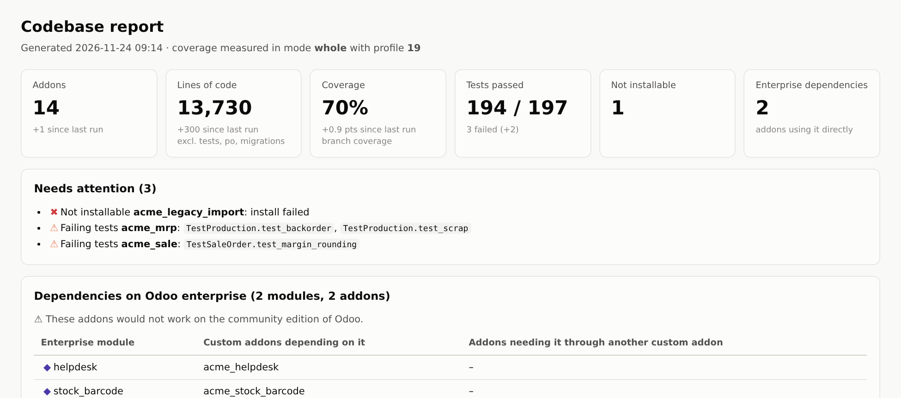
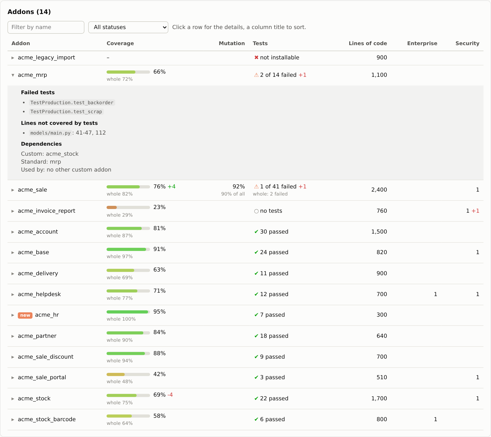
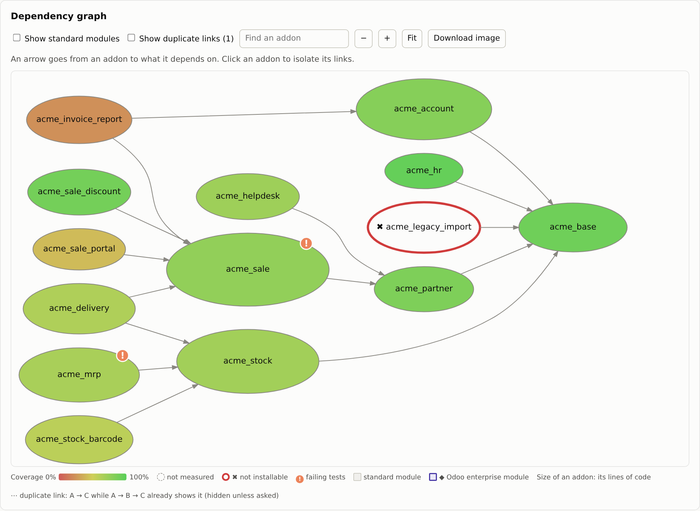
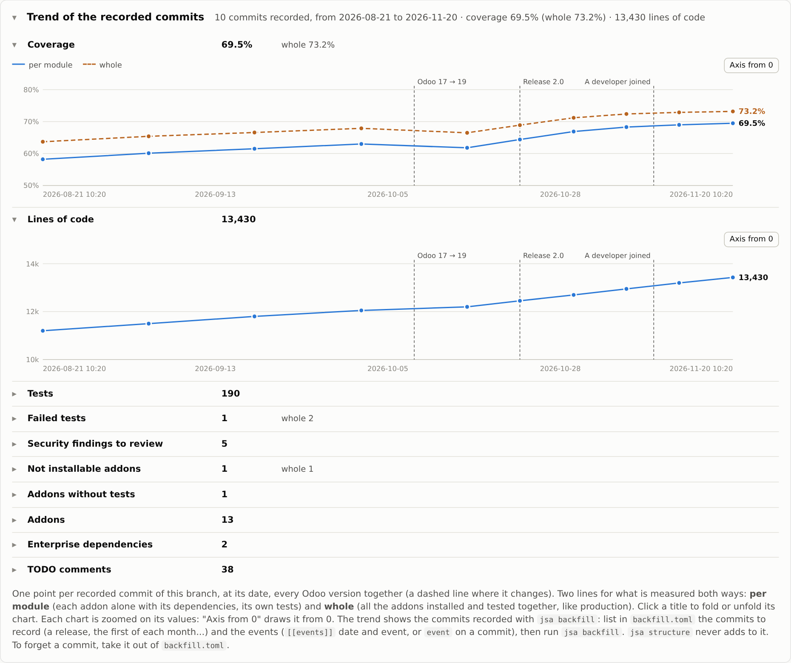
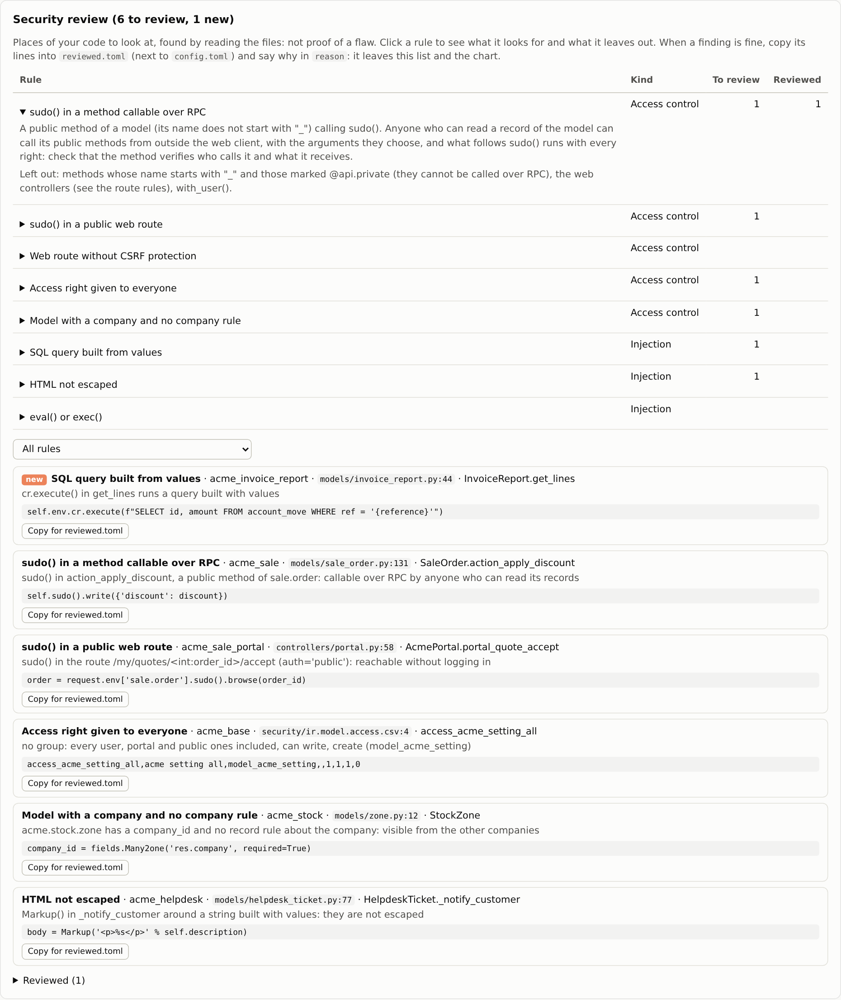
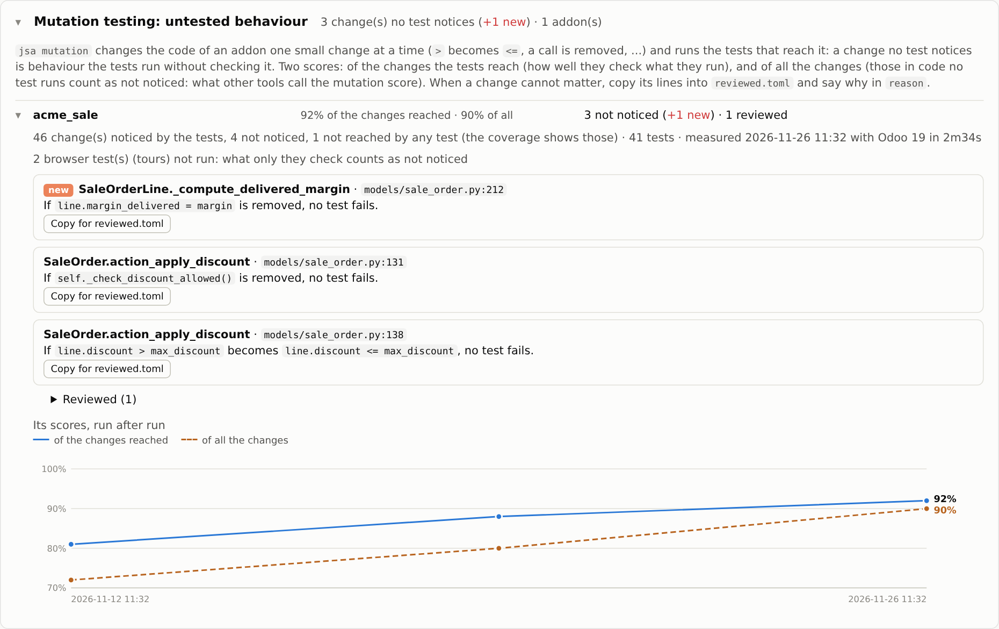

# jsa guide

Everything the [README](../README.md) leaves out: the full setup, the configuration, how each command works, your own
commands and the development of jsa itself.

- [Installation in detail](#installation-in-detail)
- [config.toml](#configtoml)
- [Databases](#databases)
- [Codebase report and test coverage](#codebase-report-and-test-coverage)
- [Finding the commit that broke a test](#finding-the-commit-that-broke-a-test)
- [Your own commands (plugins)](#your-own-commands-plugins)
- [Odoo versions](#odoo-versions)
- [Developing jsa](#developing-jsa)

## Installation in detail

**Requirements**
- Linux, or WSL on Windows (tested on Ubuntu 22.04 and 24.04), Python 3.10 or later and `pipx`.
- PostgreSQL: the client tools (`psql`, `createdb`, `dropdb`) and a server your user can connect to without a
  password, as for Odoo itself. Your role does not need to be superuser: `restore` uses `sudo -u postgres` only for
  the extensions only a superuser can create (pgvector, used by Odoo's AI features).
- Keep PostgreSQL at least as recent as your production's, minor updates included (`sudo apt update && sudo apt
  install --only-upgrade postgresql-18 postgresql-client-18`): an older PostgreSQL can refuse what a newer one wrote
  (18.7 added a column option, `pg_attver`, that older 18.x servers reject). `restore` and `doctor` check it.
- `git`, for `jsa update`, `jsa version` and `jsa bisect`.
- Optional: graphviz (`dot`) to draw the dependency graph of the report.
- For the commands that run Odoo (coverage, `--neutralize`, `bisect`, `mutation`): the Odoo sources and a
  Python environment able to run them, described as a profile in `config.toml`.

**Install**
```bash
sudo apt install pipx postgresql-client graphviz
pipx ensurepath                      # once: puts ~/.local/bin on your PATH, then open a new terminal
git clone https://github.com/Minijump/jsa_dev_toolbox.git jsa_dev_toolbox && cd jsa_dev_toolbox
pipx install -e .                    # -e: jsa runs the code of this folder
cp config.example.toml config.toml   # then adapt it, see below
jsa doctor                           # checks PostgreSQL, pgvector, graphviz, config.toml, profiles...
```
jsa works from any folder, but always reads its dumps in `dumps/` and writes its reports in `codebase_analysis/`
inside the toolbox folder.

**What is where.** Everything in `jsa/` is the tool. Everything else at the root is yours or generated, and ignored by
git: `config.toml`, `dumps/`, `plugins/` (your commands), `codebase_analysis/` (reports).

**Updating.** `jsa update` pulls the toolbox folder and reinstalls jsa (needed when its dependencies change).
`jsa version` tells which code runs and whether the remote has newer commits. To do it by hand:
`git pull`, then `rm -rf build && pipx uninstall jsa-dev-toolbox && pipx install -e .`.

**WSL.** The reports open in the Windows browser (through `explorer.exe`).

## config.toml

`config.example.toml` holds every setting, commented. The sections:

**`[codebase]`**
- `addons_roots`: the folders of your custom addons (OCA ones included if you want them in the report). Read by
  `structure`, `pending-upgrades` and `mutation`.

**`[profiles.<name>]`**: one per Odoo installation, chosen with `-p <name>`.

| Key | |
|---|---|
| `python` | the Python that runs this Odoo (it needs `coverage` 7.6 or later installed for `structure -c`) |
| `odoo_root` | the Odoo sources |
| `enterprise` | optional: the enterprise folder. Its modules are the "enterprise modules" flagged by the report |
| `odoo_bin` | optional: default `odoo-bin` in `odoo_root` |
| `addons_paths` | optional: default your `addons_roots`, then `enterprise`, then `<odoo_root>/addons`. Give it when this Odoo uses other checkouts of your addons (two branches during a migration) |
| `db_prefix` | optional: prefix of the temporary databases of the coverage runs (default `cov`) |

**`[[restore.extra_steps]]`**: what `jsa restore` does to a restored database, after jsa's standard steps
(`jsa/db/restore_steps.toml`: 2FA off, login `admin` / password `admin`, expiration date; outgoing mail servers off,
itself switched off), one block per step, in this order.

| Key | |
|---|---|
| `label` | what is printed |
| `sql` | the SQL to run, or |
| `command` | a jsa command instead (typically one of your plugins), called with the database name at its end |
| `requires` | `["table"]` or `["table.column"]`: skipped when it does not exist (module not installed) |
| `odoo_versions` | e.g. `[19]`: skipped on the databases of the other versions |
| `enabled` | `false` keeps the step in the file without running it |

The SQL steps run in one transaction (all or nothing), then the commands one by one. A failing command is reported
and the next steps still run. A misspelled key is refused before anything starts. A step with the label of a
standard one changes it rather than adding one: `enabled = false` switches it off, `enabled = true` switches on the
mail servers step, `sql = "..."` replaces its SQL. So a `config.toml` that still holds copies of the standard steps
(from before jsa 0.34) does the same as before, and its copies can be deleted.

**`plugins_dirs`**: see [plugins](#your-own-commands-plugins).

## Databases

**`jsa restore <db> [zip]`** restores an Odoo backup zip (as downloaded from odoo.sh or the database manager):
1. The zip is looked for in `dumps/` (or given as a path; with a single zip in `dumps/` the name can be left out).
   If the dump comes from a newer PostgreSQL than your server (or was written by a newer `pg_dump` than your
   `psql`), restore stops before changing anything and gives the command to update (`--ignore-pg-version` goes on
   anyway). Then only `dump.sql` and `filestore/` are extracted.
2. `<db>` is dropped and created again. The extensions only a superuser can create are created first, with
   `sudo -u postgres` when your role is not superuser (`--postgres-user` for another system user).
3. The dump is loaded with a progress line. SQL errors stop it before anything is sanitized
   (`--ignore-sql-errors` goes on anyway); the harmless "must be owner of extension" ones are ignored.
4. The filestore, if any, goes to `<data-dir>/filestore/<db>` (`--data-dir`, default `~/.local/share/Odoo`).
5. `--neutralize -p <profile>` runs `odoo-bin neutralize` (Odoo 16+; odoo.sh dumps are already neutralized).
6. The steps of `config.toml` run, then the database is saved as its snapshot (`--no-snapshot` skips it: it doubles
   the disk space), and the addons whose code version differs from the installed one are listed.

```text
$ jsa restore mydb
📦 Using backup: /home/me/jsa_dev_toolbox/dumps/prod-2026-11-06.zip
🔌 Creating extension(s) vector as 'postgres' (sudo)...
📥 Restoring database...
   SQL executed in 01:42: 1154 tables, 1154 data blocks, 5520 indexes/constraints
🗂️ Restoring filestore to /home/me/.local/share/Odoo/filestore/mydb...
🔄 Sanitizing database...
✅ 2FA disabled for all users
✅ Admin login set to 'admin'
✅ All passwords set to 'admin'
✅ Expiration date set to 2135-12-31
📸 Saving 'mydb' to 'mydb__snapshot'...
⏫ 2 addon(s) of 'mydb' have a different version in the code:
   acme_sale: 19.0.1.4 → 19.0.1.5
   acme_stock: 19.0.2.0 → 19.0.2.1
   To update them:  -u acme_sale,acme_stock
🎉 Database 'mydb' restored
```

**Snapshots.** `jsa snapshot <db>` saves `<db>` and its filestore as `<db>__snapshot` (a PostgreSQL template copy:
seconds). `jsa reset <db>` puts it back, e.g. to replay a migration script, then lists the addons to update.
`jsa clone <db> <new>` copies a database and its filestore, and saves the copy as its snapshot. One snapshot per
database; it shows in `jsa list`; `jsa remove <db>` deletes the database, its filestore and its snapshot,
`jsa remove <db>__snapshot` the snapshot only. Stop Odoo on a database before copying it: PostgreSQL refuses to copy
a database in use.

**`jsa pending-upgrades <db>`** compares the version of each custom addon's manifest with the version installed in
the database (`1.2` in a manifest is `19.0.1.2` for Odoo 19). It only lists them, with the `-u` argument to paste.

**`jsa enterprise <db>`** lists the Odoo enterprise modules installed (license `OEEL-1`): first those your code needs,
then the other applications and modules. Useful before moving a database to the community edition.

**`jsa exp-date <db>`** pushes the expiration date of a database to 2135 (also a step of `restore`).

## Codebase report and test coverage

`jsa structure` writes `codebase_analysis/report.html`, a single page that works offline (`jsa report` opens it).



- **Tiles**: addons, lines of code (without tests, translations and migrations), coverage (branch coverage: each
  line, and each direction of each `if`, of the code inside functions run by the tests: see below), tests, addons
  that cannot be installed, dependencies on Odoo enterprise;
  with their change since the
  last run (its tooltip says which run: the measures compare with the last run measured the same way).
- **Needs attention**, **changes since the previous run**, the **dependencies on Odoo enterprise** (direct, and through
  another custom addon).
- **Security review**: the places of your code to look at, below.
- **A table of the addons**, sortable and filterable; a click opens the failed tests, the lines not covered, the
  dependencies and who uses the addon. A column counts its security findings to review; once `jsa mutation` measured
  it, another gives its mutation score (below).



- **The dependency graph**, with or without the standard modules. Color = coverage, size = lines of code, ✖ = not
  installable, ! = failing tests. "Duplicate links" (A → C when A → B → C already shows it) are hidden unless asked.
  "Download image" saves the graph as shown.



- **Trends**, run after run, one chart under the other: coverage and lines of code open, the others folded (tests,
  failed tests, security findings to review, addons not installable, addons without tests, addons, enterprise
  dependencies, your own measures), each titled with its last value. Each chart is zoomed on its values (coverage
  going from 80% to 82% shows); its button "Axis from 0" draws it from 0 instead (in the trends of the other way of
  measuring too). Each run is placed at the date of the code it measured: the last commit of your addons folders
  (or the date of the run when they had uncommitted changes). So you can fill the past: `jsa backfill` (below).

**Filling the past.** List old commits of your addons in `plugins/backfill/backfill.toml` (copy
`backfill.toml.sample`), with your events, then run `jsa backfill` (`--dry-run` first: it shows each commit with its
Odoo version and profile). For each commit, in a temporary checkout (yours is not touched): the Odoo version is read
in the manifests (`17.0.1.0.0`: Odoo 17), the profile running that version is used (or the one given in `[profiles]`
of the file), and the addons are measured like `jsa structure -c -m whole`, then `-m isolated` (`modes` of the file
to keep one). One difference with `jsa structure`: in `whole`, an addon that does not install (or needs a module
found in no addons path) makes all the addons count as not installable, as in production: coverage 0%, no test, a
single install per commit (the broken addon's note says why, the others say "not tested"). A test that gets stuck is
still skipped and counted failed, the others run. The runs go in the trends at the date of the commit; the reports of each commit stay in
`codebase_analysis/backfill/<commit>/<mode>/`. A measure already taken is skipped, so a backfill that stopped goes on
where it was, and a commit added to the file (anywhere: the charts follow the dates) is the only one measured.
`backfill.toml` decides what the backfill part of the history holds: a commit, a mode or an event removed from it
leaves the history (`--dry-run` says how many lines); the runs of `jsa structure -c` and the events added by hand
stay. A measure added to `config.toml` (`[[report.measures]]`) is counted on the commits already measured, in seconds:
their code only, no install, no test. Each commit is two full measures: count hours for many commits. Needs all the `addons_roots` in one
git repository. In a terminal, a block stays at the bottom while the messages scroll above it: which measure of how
many (which commit, mode, time elapsed and left), what Odoo does (the addon, its tests so far) and the test that
runs, with how long it has been running.

**Which charts.** By default every chart is shown (your measures last), coverage and lines of code unfolded. To
choose, in `config.toml`:
```toml
[report]
trends = ["coverage", "loc", "tests", "TODO comments"]  # the charts shown
trends_open = ["TODO comments", "coverage"]             # unfolded at first
```
The unfolded charts come first, in the order of `trends_open`, then the folded ones in the order of `trends`.
The charts: `coverage`, `loc` (lines of code), `tests`, `failed`, `security`, `not_installable`, `no_tests`,
`addons`, `enterprise`, and the labels of your measures. Either key can be left out (it keeps its default).



**Your own measures.** A pattern counted in the code of your addons, drawn as a trend: TODOs going down, a deprecated
call disappearing during a migration, `sudo()` calls, ... In `config.toml`:
```toml
[[report.measures]]
label = "TODO comments"
pattern = '\bTODO\b'              # a regular expression; single quotes keep the backslash
files = ["*.py", "*.js", "*.xml"] # optional: only these files
```
It is counted in the files of the lines of code (no tests, translations, migrations) and recorded by each run that
measures the coverage (`-c`).

**Security review.** Each `jsa structure` (with or without `-c`) reads the code of your addons (no tests,
translations, migrations, upgrades) and lists the places to look at, in seconds, without Odoo. Eight rules, from the
pitfalls of Odoo's security documentation:

| Kind | Rule |
|---|---|
| Access control | `sudo()` in a public method of a model (anyone who can read its records can call it over RPC) |
| | `sudo()` in a web route open to visitors who are not logged in (`auth='public'` or `'none'`) |
| | a web route with `csrf=False` |
| | an access right of `ir.model.access.csv` with no group that allows to write, create or delete |
| | a model with a `company_id` and no record rule about the company |
| Injection | a query given to `cr.execute()` built with values (an f-string, `%`, `+`, `.format()`) |
| | HTML not escaped: `Markup()` around a built string, `t-raw`, an `Html` field with `sanitize=False` |
| | `eval()` or `exec()` |

In the page, each rule is a line that unfolds: its line says how many findings it has to review and what changed
since the previous report (`+2 new`, `−1 gone`; the section's title gives the totals); unfolded, it shows what it
looks for and what it leaves out (the same text as in the code: `jsa/structure/security.py`, one function per rule),
then its findings, the new ones first. A rule you do not want can be switched off in `config.toml`:
```toml
[security]
skip = ["csrf_off", "company_rule"]   # the keys of the rules (each fold gives its key); ["*"] = no review at all
```



A finding is a place to look at, not a proven flaw. When it is fine, "Copy for reviewed.toml" gives its lines: paste
them into `reviewed.toml`, next to `config.toml` (yours: ignored by git), and say why in `reason`:
```toml
[[security]]
id = "2703320406"  # sudo() in a method callable over RPC | my_addon/models/sale.py | Sale.action_confirm
reason = "only managers reach it: the method checks the group"
```
It then leaves the list (it is shown folded under "Reviewed" in its rule, with its reason) and the chart. Its id stays the same
when lines move, and changes when its code changes (to look at again). The lines of `reviewed.toml` whose finding is
gone are pointed out; a line without a reason stops the command. The chart "Security findings to review" counts, for
each run, the findings not reviewed in today's `reviewed.toml`: reviewing one lowers the whole curve. Like your
measures, it is recorded by the runs that measure the coverage (`-c`); `jsa backfill` adds it to the commits already
measured, in seconds.

**Events.** To see the trends before and after a release, someone joining the team, ..., add a line by hand to
`codebase_analysis/history.jsonl`: `{"date": "2026-11-01", "event": "Release 2.0"}`. It is drawn as a dashed vertical
line on every chart, once runs were measured before and after it.

**Measuring the coverage.** `jsa structure -c -p <profile>` installs the addons in temporary databases (dropped
afterwards), runs their tests under `coverage`, and puts the results in the report. Three ways:

| Mode | What it does | Catches |
|---|---|---|
| `-m whole` (default) | all addons installed and tested together, in one database | what fails in production conditions; fastest |
| `-m isolated` | each addon on a database holding only its dependencies (built from snapshots of the dependencies already installed) | undeclared dependencies |
| `-m both` | the coverage of `isolated`, then all addons tested together without coverage | both; a test failing only with all the addons is marked "(with all the addons)" |

- An addon that fails to install is left out with the addons depending on it, and the others are tried again. One
  needing a module found in no addons path is left out before the install. (`jsa backfill` stops there instead: all
  or nothing.)
- A test, or the `setUpClass` of a test class, taking more than 10 minutes (`test_timeout` of `[codebase]` in
  `config.toml`) is stopped and fails; a class whose `setUpClass` fails runs none of its tests, and each of them is
  marked failed. A test catching every error cannot keep running. The database gives up a lock waited for longer
  than the limit: the test fails with that error. When no test starts for 1 minute more, the queries still running
  are cancelled: the test fails, the run goes on. Only what neither stops (stuck elsewhere): Odoo is stopped and the
  tests run again without that test (or that class), counted as failed; the rest of the addon is measured. Stopped
  while installing (no test running, 5 minutes more), the addon is left out (it counts as 0%, its note says "Odoo
  stopped answering while installing it") and the others are tested again. `test_timeout` can be below a minute (`0.5`), but a slow test or setUpClass would then fail too. The run says the limit it uses ("each test and setUpClass 10 min at most");
  `test_timeout` written in another table of `config.toml` is reported, as it is not read there.
- An addon that does not install (or is marked not installable) counts as 0% covered in the total: its tests never
  ran. Its lines and branches are counted as coverage would have measured them, so the coverage goes up when it
  becomes installable, never down.
- `--standard-tests` (whole, both): also runs the tests of the standard modules your addons need, with your addons
  installed, like odoo.sh does. Long (`base` alone has about 1000 tests).
- Demo data is always installed: tests written for a database with demo data keep passing on Odoo 19.
- What counts: **the code inside functions, run by the tests**. Imports, field definitions, class and `def` lines,
  decorators run when Odoo imports the module, tested or not: they are left out (they made an addon without tests
  show 40% and more). Code run while installing (demo data running computes and `create` overrides) does not count
  either: only what runs from the `setUpClass` of a test class to its `tearDownClass`. So an addon without tests is
  at 0%. Tests that run code without checking it still count it: that is the limit of any coverage. Needs coverage.py
  7.6 or later in the Python of the profile (`jsa doctor` says it; `<python> -m pip install -U coverage`).
- Not measured: tests, manifests, `__init__.py`, hooks and migration scripts, which only run when a module is
  installed, upgraded or uninstalled.
- Only what changed is measured again: in `isolated` and `both`, an addon keeps its last result while its code, its
  custom dependencies, the Odoo commit and the mode are the same. In `whole`, any change runs everything. `--all`
  measures everything.
- Without `-c`, the report keeps the last measures of the unchanged addons.

**Files** next to the report: `state.json` (the last results, also the cache), `history.jsonl` (one line per measured
run, for the trends: delete a line to forget a run; your events), `coverage_odoo.log` (the full Odoo log of the last
measure).
Runs are only compared with runs measured the same way: whole, or one by one (isolated and both), picked above the
charts. Every Odoo version is on the same curve, so the coverage on Odoo 17 and on 19 compare; a dashed line marks
where the version changes, and when there are several, each version alone is one choice away. The runs made before
jsa 0.31 counted the coverage another way (every line of the files, installing included, so higher): to keep the
trend comparable, delete `codebase_analysis/history.jsonl` (and run `jsa backfill` again if you use it).

**Mutation testing: what the tests run without checking it.** Coverage says which code the tests run, not whether they
check what it does. `jsa mutation <addon>... -p <profile>` changes the code of an addon one small change at a time (a
mutant: `>` becomes `<=`, `and` becomes `or`, a `not` is removed, `+` becomes `-`, a number changes, a call or an
assignment to a field is removed, ...) and runs the tests that reach it. A change that no test notices is listed in the
report: "If `move._post()` is removed, no test fails". Meant for your critical addons (`[mutation] addons` of
`config.toml` when none is given); Linux only (WSL).
- How long: Odoo is loaded once, then each mutant runs in a copy of it (fork), with only the tests that reach it, on
  several workers (`-w`, each an Odoo with its own database). Measured: 2 minutes for an addon of 800 lines, 3 when
  its test classes build a lot of data (accounting). The addons that did not change (nor those they depend on, Odoo,
  the rules) keep their results: running it again costs nothing (`--all` measures them again).
- What is never changed: text (error messages, strings), `raise`, logging, `_()`, `ensure_one()`, `super()` calls,
  field definitions; the kinds of changes that cannot matter (the id of `(0, 0, vals)`, the default of
  `.get(k, 0.0)`, `return True` of a button, the number of a comparison) or that nobody tests (the action a method
  returns to the web client, chatter messages and activities, names taken from a sequence); the methods matching
  `[mutation] skip` (globs: `"action_view_*"`, `"SaleOrder._compute_display_name"`).
- No false alarm, as far as it can: the tests run twice first, and those failing or flaky are left out; a change
  that survives but whose code also runs while installing (values computed then, on the demo data) is checked again
  by a real install with that change. Browser tests (tours) are not run: what only they check shows as not noticed
  (the report says how many). Some changes cannot matter at all (a fast and a slow path giving the same result): in
  the prototype, about 3 in 100; when one is listed, copy its lines into `reviewed.toml` and say why in `reason`
  (`[[mutation]]`, like the security review): it is shown folded.
- In the report: a section per addon (its score: the share of the changes reached that a test noticed; the changes
  not noticed, by function; its score run after run), and a "Mutation" column in the table. "Not reached by any test"
  is the coverage's job: those are only counted.



- Files: `codebase_analysis/mutation/<addon>.json` (the results), `<addon>_odoo.log` (installing), `<addon>_tests.log`
  (the tests of the workers).

## Finding the commit that broke a test

```bash
jsa bisect /acme_sale.test_margin_rounding <good commit> [bad commit] -p 19
```
`git bisect`, with Odoo trying the test at each commit. The test is usually one you just wrote to reproduce a bug, so
it exists in none of the commits searched: it comes from your checkout, committed or not.
- The `tests/` folder of the module is copied into each commit tried (its helpers come along); only the file holding
  the test is loaded, so another test needing newer code cannot get in the way. The test is written as in
  `--test-tags`: `/module.test_name` or `/module:TestClass.test_name`.
- The commits are checked out in a temporary git worktree (submodules included): your checkout is never touched, you
  can keep working.
- Each commit gets a new database, deleted afterwards. `--fast` installs the modules from outside the repository once
  and copies that database: faster, but every commit then gets the modules needed by the bad commit.
- Both ends are tried first: the test must fail at the bad commit (default: the current one) and pass at the good one.
- A commit where the module does not install, or the test cannot be loaded, is skipped; if only skipped commits are
  left, the possible ones are listed.
- Ctrl-C stops it cleanly: no database, worktree or temporary folder is left.

## Your own commands (plugins)

A plugin is a `*.py` file of `plugins/` (ignored by git) with a `register(app)` function, like jsa's own features:
```python
import typer

from jsa import config, pg


def users(db: str):
    """Count the users of a database."""
    count = pg.psql(db, "SELECT count(*) FROM res_users;").strip()
    typer.echo(f"👋 {db} has {count} users")


def register(app: typer.Typer):
    app.command()(users)      # jsa users <db>
```
- A plugin can also be a folder of `plugins/` with an `__init__.py`: its own files (settings, data) then live next to
  its code, and its modules can import each other.
- Take jsa's helpers from `jsa` itself (`from jsa import pg, config, addons, ui`): that import keeps working whatever
  the folders inside jsa become.
- To version your plugins privately, keep them in another repository and list its folder in `plugins_dirs` of
  `config.toml`.
- A plugin's command can be a step of `restore`: `command = "users"` in a `[[restore.extra_steps]]`.
- A broken plugin is reported and skipped: jsa's own commands keep working. Files starting with `_` are not plugins.

The examples:
- `plugins/quote_pdfs/` puts back the PDF files of the quotation headers and footers (Odoo 18+, quotation builder),
  lost with a dump without filestore: `jsa quote-pdfs <db> -p <profile>` (`--list` shows the ids). Its
  `documents.toml` (id = file, see `documents.toml.sample`) and your PDFs go in that folder, ignored by git.
- `plugins/backfill/` measures old commits for the trends of the report: `jsa backfill` (see "Filling the past"
  above), its `backfill.toml` in that folder, ignored by git.

## Odoo versions

Used daily on Odoo 19, tested on 17 and 19; 18 and later versions should work, nothing being tied to a version number
except:
- `quote-pdfs`: Odoo 18 and later; `restore --neutralize`: Odoo 16 and later (both say so otherwise);
- demo data, loaded by default up to Odoo 18 and on request from 19: the coverage and test databases always get it.

## Developing jsa

**Layout.** One folder per feature in `jsa/`, built on `core/`:

| | |
|---|---|
| `cli.py` | the entry point: registers every feature and plugin through its `register(app)` |
| `core/` | config, PostgreSQL, addons on disk, running Odoo, plugins, terminal output (no command) |
| `db/` | restore, databases, modules |
| `structure/` | codebase report, coverage, bisect |
| `doctor.py`, `self_update.py` | `doctor`, `version`, `update` |

A feature never imports another one: what two of them share goes in `core/`.

**Conventions.** Output through `typer.echo` with an emoji prefix (✅ ❌ ⚠️ 🔄 ...); an error ends with
`typer.Exit(code=1)`. Only use what `typer` exposes: recent versions of Typer bundle click, there is no `click` to
import.

**Tests.** `pip install -e ".[dev]"`, then `pytest`: unit tests, no database or Odoo needed, a few seconds.

**License.** MIT, see [LICENSE](../LICENSE).
